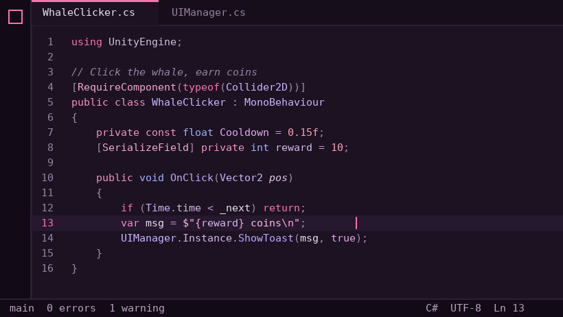
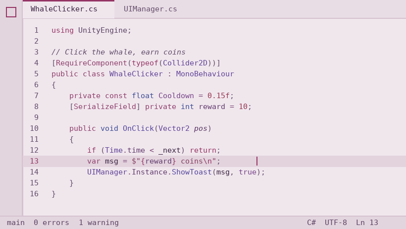
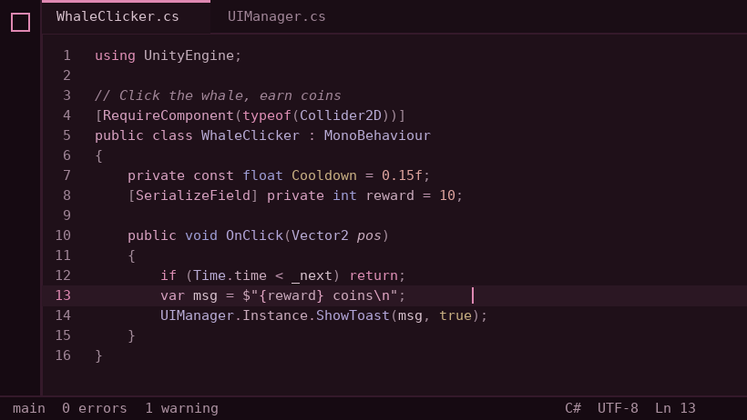
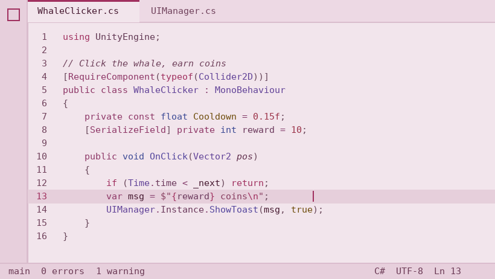
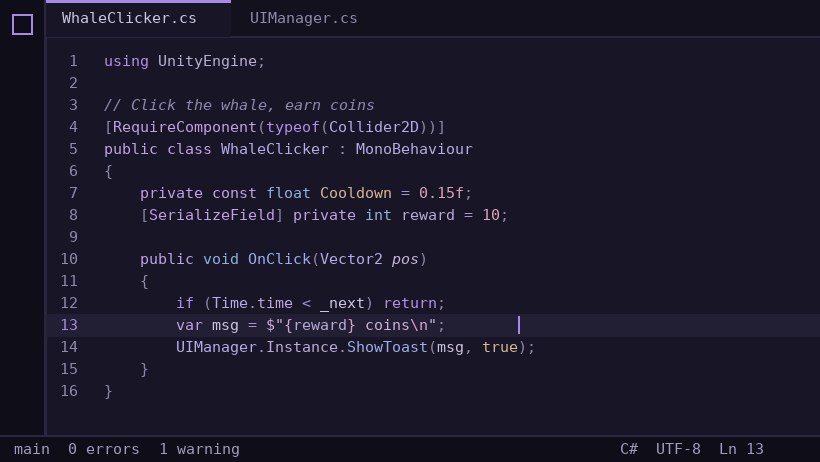
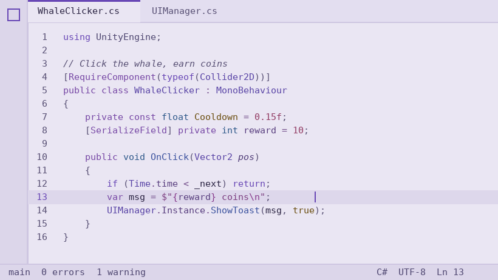
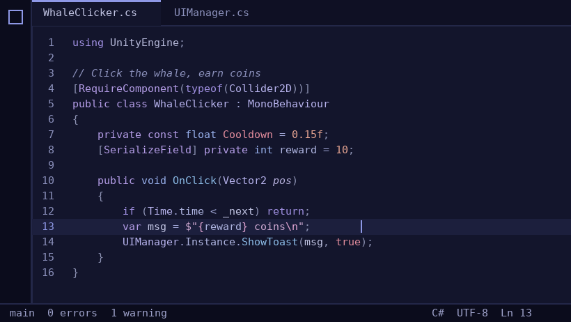
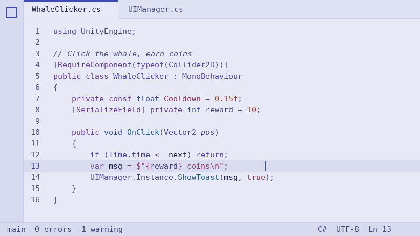

# Pore Theme

캐릭터 Pore, Malkuth, Demon Night 일러스트의 색감으로 만든 고딕 파스텔 VS Code 테마 모음입니다. 8종이 들어 있고, 테마마다 일러스트 배경이 함께 들어 있습니다. 테마를 바꾸면 배경도 리로드 없이 바로 바뀝니다.

눈 피로를 줄이기 위해 다크 테마는 본문 대비를 11:1 이하, 문법 색은 9.5:1 이하로 제한하고, 라이트 테마는 배경 밝기를 순백보다 낮췄습니다. 모든 색은 WCAG AA(4.5:1) 이상입니다.

| 버전 | 에디터 배경 | 포인트 색 |
|------|------|------|
| Pore Dark | `#1C1222` | `#DC82AD` |
| Pore Light | `#F0E7ED` | `#963565` |
| Pore Snow Dark | `#1F1019` | `#DF88B2` |
| Pore Snow Light | `#F2E5EC` | `#A0305F` |
| Malkuth Dark | `#181526` | `#A68AE6` |
| Malkuth Light | `#EAE6F3` | `#6847B5` |
| Demon Night Dark | `#13152C` | `#8E98E6` |
| Demon Night Light | `#E7E9F6` | `#3F4DB3` |

















## 설치

### 한 줄 설치 (Windows PowerShell)

```powershell
& ([scriptblock]::Create((irm https://raw.githubusercontent.com/FTVOT-STUDIO/pore-theme/main/install.ps1)))
```

최신 릴리스를 받아 설치합니다. VS Code를 다시 열면 테마가 `Pore Snow Dark`로 바뀌고, 오른쪽 아래 **다시 로드**를 한 번 누르면 배경까지 적용됩니다. 다른 테마로 시작하려면 끝에 `-Theme "Malkuth Dark"`처럼 붙이시면 됩니다.

### 수동 설치

1. [Releases](https://github.com/FTVOT-STUDIO/pore-theme/releases/latest)에서 `pore-theme-2.3.0.vsix` 다운로드
2. VS Code에서 `Ctrl+Shift+P` 누르고 `Extensions: Install from VSIX...` 선택한 뒤 파일 지정
3. `Ctrl+K Ctrl+T`에서 `Pore` 계열 테마 선택

CLI로 설치할 수도 있습니다.

```bash
code --install-extension pore-theme-2.3.0.vsix
```

## OS 다크/라이트 모드에 맞춰 자동 전환

`settings.json`:

```json
{
  "window.autoDetectColorScheme": true,
  "workbench.preferredDarkColorTheme": "Pore Dark",
  "workbench.preferredLightColorTheme": "Pore Light"
}
```

## 색 바꾸기

`build/generate.py`의 팔레트(`DARK`, `LIGHT`, `SNOW_DARK`, `SNOW_LIGHT`, `MALKUTH_DARK`, `MALKUTH_LIGHT`, `DEMON_DARK`, `DEMON_LIGHT`)를 수정한 뒤 [개발](#개발) 항목의 명령을 순서대로 실행하시면 됩니다.

## 접근성

모든 문법 색상은 에디터, 사이드바, 위젯 배경 대비 WCAG AA 4.5:1 이상으로 맞췄습니다.

## License

MIT. 자세한 내용은 [CREDITS.md](CREDITS.md)를 참고해 주세요.

## 배경 이미지

| 테마 | 기본 배경 |
|------|------|
| Pore Dark / Light | Pore 나들이 일러스트 (오른쪽 아래) |
| Pore Snow Dark / Light | Pore 겨울 일러스트 |
| Malkuth Dark / Light | Malkuth 교실 일러스트 |
| Demon Night Dark / Light | Demon Night 일러스트 |

**어떻게 동작하나요**

- 처음 실행할 때 VS Code 워크벤치에 CSS를 한 번 주입합니다. 이때만 **다시 로드**가 필요합니다.
- 그 뒤로는 테마를 바꾸면 CSS가 현재 테마를 인식해 배경을 즉시 바꿉니다. 설정 파일도 건드리지 않고 리로드도 없습니다.
- 배경 이미지는 `~/.pore-theme` 폴더에 복사해 두고 사용합니다. 원본을 지우거나 옮겨도 배경은 유지됩니다.
- VS Code를 업데이트하면 주입한 CSS가 사라지는데, 다음 실행 때 자동으로 다시 넣고 **다시 로드**를 한 번 안내합니다.
- 별도 확장(Background 등)은 필요 없습니다.

**배경 바꾸기 / 끄기**

- `Ctrl+Shift+P` → `Pore Theme: 현재 테마에 배경 이미지 지정` → 이미지 선택. VS Code 내장 테마나 다른 확장 테마에도 지정할 수 있습니다.
- `Pore Theme: 현재 테마의 배경 이미지 제거`
- `Pore Theme: 배경 기능 끄기 (VS Code 원본 복구)`. 확장을 제거할 때도 자동으로 원본을 복구합니다.

```jsonc
// settings.json에서 직접 편집할 수도 있습니다
"poreTheme.backgrounds": {
  "Pore Snow Dark": "C:/Users/me/Pictures/my-snow.png",
  // 크기와 위치도 지정 가능 (CSS background-size / background-position)
  "Dark Modern": { "path": "C:/Users/me/Pictures/other.png", "size": "auto 80%", "position": "right bottom" }
},
"poreTheme.background.opacity": 0.08
```

**참고**

- VS Code 내부 파일(`workbench.html`)을 수정하는 방식이라 VS Code가 "설치가 손상된 것 같습니다" 알림을 띄울 수 있습니다. 이 알림은 자동으로 숨깁니다.
- VS Code를 관리자 권한이 필요한 위치(예: `C:\Program Files`)에 설치했다면 파일을 수정할 수 없어서 배경이 적용되지 않습니다. 사용자용 설치본(기본값)은 문제없습니다.

## 개발

```bash
python3 build/generate.py        # 팔레트 → 테마 JSON
python3 build/check_contrast.py  # 대비 하한/상한 검사
node test/extension.test.js      # 배경 전환 로직 테스트
python3 build/package_vsix.py    # dist/*.vsix
```
